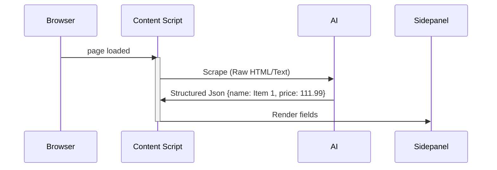
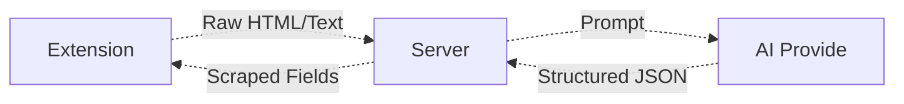
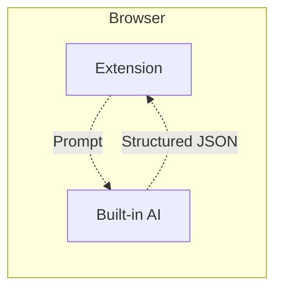

# System design journey of a AI powered form integration

## The Project
Design system to assist users to fill out the form on a browser extension by scraping the webpage. Started with dom parsing for the known vendor websites. But there are a bunch of websites were missing. Identifying the layout and keep updating the dom tree mappings manually is tedious. We also have a click to copy tool which highlights an element on hover and upon click copies the text under the highligted element will be copied to the focused field on the extension.
Both works very well but still there is a manual effort. 

## The Solution
The websites are unreliable, different websites behave and structures differently, in a website different types of products have different kind of layouts, some uses SPA. Which makes it more unreliable. Its a viable problem to solve with AI. Ultimately we need to find the value or a dom path of a field. A fine prompt can be used to scrape all the fields from the website and return in a json format. 
The key characteristics considered are accuracy, latency and cost effective.  

## Approach 1: Cloud
The first approach is to use any leading cloud AI service providers to scrape the fields. The extension should be get raw html or text content from the webpage and send it over http api to our server. The server then passes talks to the AI cloud service provider and returns the scraped fields in a structured json format.

### Pros
 - High accuracy
 - Easy to implement
 - Easy to maintain

### Cons
 - Its may not be cost efficient
 - Unreliable latency
 - Huge payload

## Approach 2: Gemini Nano
During this project I've discovered that the chrome browser has built-ai features. Since our target customers mostly on chrome, we can leverage this feature. So that there will be no cost involved and the data will live with in the browser itself. 

### Pros
 - Cost effective
 - Less maintenance

### Cons
 - Its still an experimental feature.
 - Unreliable model availability. We don't have control over downloading the model.
 - Unlike the classifiers or image models, llm models are fairly large
 - Unreliable performance and vary on different machines.
 - Hard limit on context window
