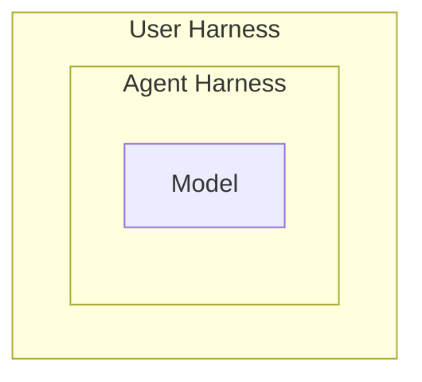
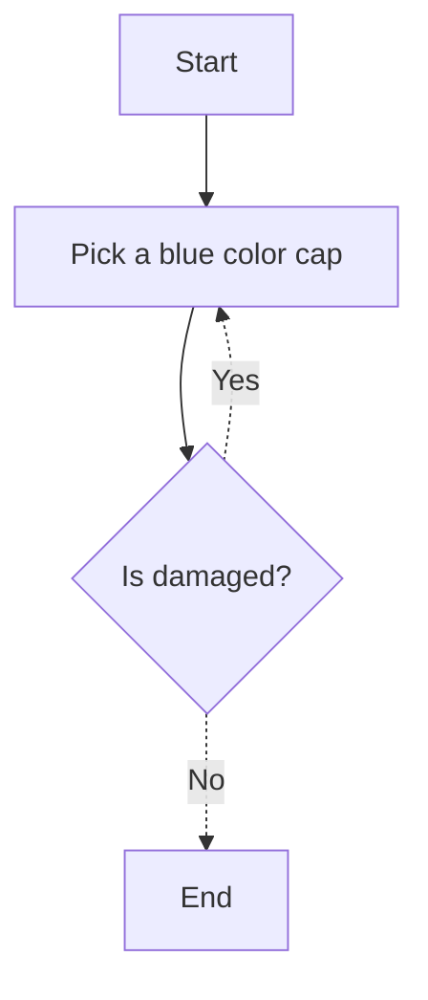

# User Harness - Steer your agents to work for you and your org

## What is an Agen?
Agents are software systems that autonomously perceive their environment, make decisions, and take actions to achieve goals

## What is Harness?
Everything in an AI agent except the model itself
Agent = Model + Harness

Coding Agents are nothing but a harness with a coding model in an IDE

You might have seen its reasoning, tool calling, etc., when an agent is trying to achieve your goal.

## What is User Harness?

Even though the harness has been built on the coding agent, it has a very wide scope. 
We should narrow it down to work specifically for our case and system.

## Why does it matters?
- Person 1: I like blue color.
- Person 2: I like red  but I dont like or dislike blue.
- Person 3: I like dont like blue.
- Person 4: I dont bother about colors.

Assume each one asking their agent to buy a cap for them. 
The agent may buy a blue color cap randomly to Person 3 where he dont like it. 
If the agent know their preferences, it might buy the right cap for them. 

Blue for Person 1. 
Red if possible or blue for Person 2. 
Anything except blue for Person 3. 
Any color for Person 4.

The next gate would be it should not be damaged. Unless we instruct it to check for damage explicitly it would not. 

## How to build my Harness? 

The color preference would be feedforward information. - Guide
The damage check is a feedback loop. - Sensor

You should not instruct the agent to buy a blue color hat. 
You should provide the environment, principle and guidelines
The should take the decision

https://martinfowler.com/articles/harness-engineering/harness-overview.png

You are not choosing blue as your favourite all of a sudden. 
There must be a lot of events and reasons behind that choice that you may not be aware of.
You make decisions based on those learnings.

## Harness Engineering

Every decisions, principles and standards of an org must be recorded and provided on demand as a guide to the agent. 
Static analyzer, linter, unit tests etc., as a sensors and loop back the failure to the agent again to fix it.

Agents are software systems that autonomously perceive their environment, make decisions, and take actions to achieve goals.

Move from Prompt to Harness Engineering

Build a deterministic layer around the non-deterministic and probabilistic agents

Turn single-turn answers into an autonomous multi-step execution. 

## Final thoughts
Man loading bricks over his head to carry to the top floor
A man loading bricks to a small crane to move it to the top floor. 

AI is a tool and it does not replace ENGINEERING 

## Resources
 - [User Harness](https://martinfowler.com/articles/harness-engineering.html)
 - [AI Native Engineering](https://ainativesoftware.engineering/roadmap)
