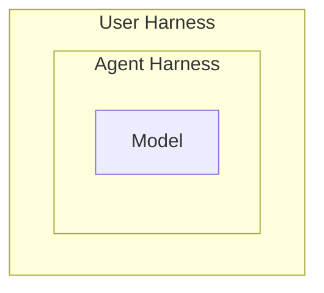
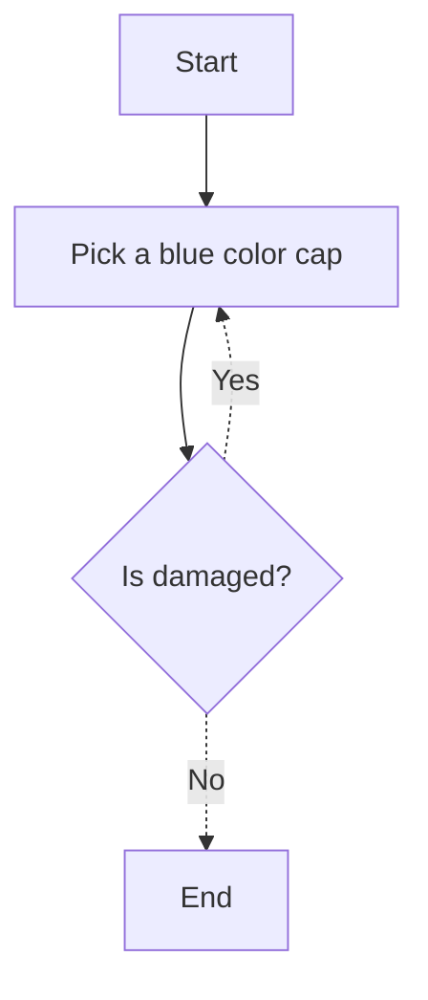

# User Harness - Steer your agents to work for you and your org

## What is an Agen?
Agents are software systems that autonomously perceive their environment, make decisions, and take actions to achieve goals

## What is Harness?
Everything in an AI agent except the model itself
Agent = Model + Harness

Coding Agents are nothing but a harness with a coding model in an IDE

You might have seen its reasoning, tool calling, etc., when an agent is trying to achieve your goal.

## What is User Harness?

Even though the harness has been built on the coding agent, it has a very wide scope. 
We should narrow it down to work specifically for our case and system.

## Why does it matters?

## How to build my Harness? 

## How to scale it to Org?

Skill
Agent Loop
Agent Orchestration
Orchestration of Agent Orchestration

## Final thoughts
Man loading bricks over his head to carry to the top floor
A man loading bricks to a small crane to move it to the top floor. 

AI is a tool and it does not replace ENGINEERING 

## Resources
 - [User Harness](https://martinfowler.com/articles/harness-engineering.html)
 - [AI Native Engineering](https://ainativesoftware.engineering/roadmap)
